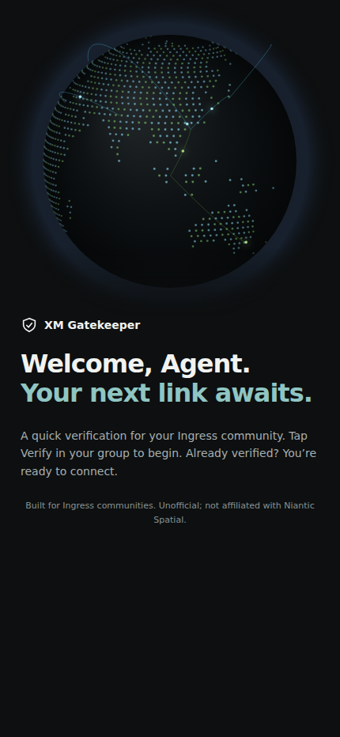
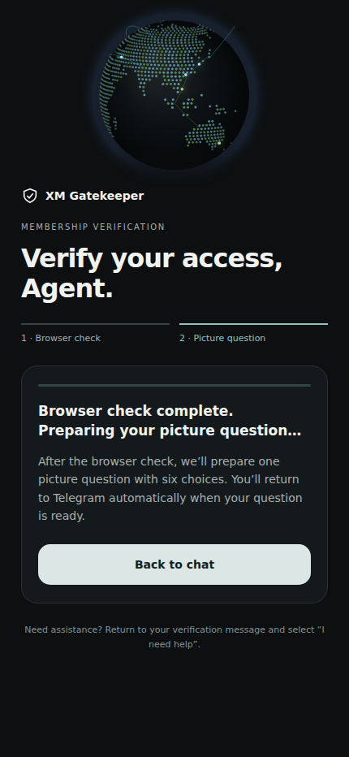

# XM Gatekeeper

[](https://github.com/haruseed/xm-gatekeeper/actions/workflows/ci.yml)
[](LICENSE)


A self-hosted Telegram bot that verifies new members of Ingress community groups
before they can participate.

XM Gatekeeper runs as a single Bun process backed by SQLite: no Redis, PostgreSQL or
external CAPTCHA service is required.

> [!WARNING]
> **Alpha release (v0.1.0-alpha.1).** Interfaces, configuration and the database
> schema may change before 1.0. Evaluate the bot with a dedicated test bot and group
> before deploying it to a live community.

## Contents

- [Screenshots](#screenshots)
- [Features](#features)
- [How verification works](#how-verification-works)
- [Requirements](#requirements)
- [Quick start](#quick-start)
- [Set up with an AI agent](#set-up-with-an-ai-agent)
- [Configuration](#configuration)
- [Commands](#commands)
- [Project structure](#project-structure)
- [Development](#development)
- [Security](#security)
- [Contributing](#contributing)
- [Licence](#licence)

## Screenshots

Actual Mini App pages rendered at a 430 px mobile viewport in dark mode.
The verification preview uses synthetic Telegram responses to show the state
between a completed Cap check and picture delivery. No real accounts or group data
appear in these screenshots.

| Welcome page | After the Cap check |
| --- | --- |
|  |  |

The globe animates in the app; these screenshots show a single frame.
Maintainers can regenerate them using the **Documentation screenshots** workflow.

## Features

- **Two intake modes.** Mutes new arrivals until they pass, or verifies join
  requests before approving them.
- **Layered challenge.** A self-hosted [Cap](https://capjs.js.org/) proof-of-work
  check followed by a six-choice picture question.
- **Session binding.** Every challenge and answer is bound to the intended user,
  group and session; another account cannot answer on a newcomer's behalf.
- **Fast delivery.** Challenge boards are pre-rendered into an image bank, and
  Telegram file IDs are cached, so no image is rendered at join time.
- **Durable processing.** Updates are persisted to an inbox before acknowledgement;
  Telegram side effects run through a transactional outbox with bounded workers
  and resume after a restart.
- **Administrator tooling.** Guided setup, manual review, audit log, raid controls,
  and moderation by reply, `@username` or numeric ID.
- **Localisation.** Verification messages in English, Traditional Chinese and
  Simplified Chinese. Administrator interfaces are in English.

## How verification works

1. A new group member is muted. A join requester remains outside the group until approved.
2. The bot sends a challenge bound to that user and group.
3. **Cap check**: the user opens the bot's Telegram Mini App and completes a
   browser proof-of-work check. A private-chat fallback is available.
4. **Picture question**: the user picks the matching image from six choices.
   Retries, skips and language changes share a single deadline.
5. On success the user is unmuted or the join request is approved. Failed and
   timed-out attempts are handled according to the group's settings and can be
   inspected with `/review` and `/audit`.

Group notices that verification was not completed disappear after one minute.
The user stays muted and remains available in `/review`. Temporary deletion
failures are retried, including after a restart.

By default, the Cap and picture stages each have a one-minute window. If Cap is not
configured, the bot asks two picture questions instead.

> [!NOTE]
> A passed challenge adds friction against automated abuse. It does not prove that
> the user is human, nor does it establish their identity.

Launching the Mini App directly from the group requires the bot's **Main Mini App**
to be enabled in BotFather. Returning to the group after Cap waits until the picture
question is ready, although some Telegram clients may still require a manual tap.

## Requirements

| Requirement      | Notes                                                       |
| ---------------- | ----------------------------------------------------------- |
| [Bun](https://bun.sh) 1.4.4 | The tested version.                              |
| Linux or macOS   | Any platform supported by [Sharp](https://sharp.pixelplumbing.com/). Linux is recommended for production. |
| Telegram bot     | A token from [@BotFather](https://t.me/BotFather).          |
| Telegram supergroup | The bot needs **Ban users** and **Invite users via link** rights. |
| HTTPS hostname   | Optional. Required for webhooks and the Cap Mini App.       |

## Quick start

**1. Install and build the demo assets**

```sh
git clone https://github.com/haruseed/xm-gatekeeper.git
cd xm-gatekeeper
bun install --frozen-lockfile
bun run assets:build
bun run boards:build -- assets/board-bank 40
bun run assets:validate
```

**2. Verify the build**

```sh
bun run typecheck
bun test
```

**3. Configure**

```sh
cp .env.example .env
chmod 600 .env
mkdir -p data tmp
chmod 700 data tmp
```

Edit `.env` and set `BOT_TOKEN`, `DATABASE_PATH`, `ASSETS_DIR` and `BOARD_TEMP_DIR`.
See [Configuration](#configuration).

**4. Initialise the database and start**

```sh
bun run migrate
bun start
```

**5. Enrol a group**

1. Add the bot to a supergroup with **Ban users** and **Invite users via link** rights.
2. As a group administrator, send `/setup` to the bot in a private chat and follow
   the checklist to enrol and enable the group.
3. Using a second account, test both a direct join and a join request.

This minimal configuration uses long polling and the two-picture flow. To enable Cap,
see [Deployment](docs/deployment.md#https-webhook-and-cap).

> [!IMPORTANT]
> The bundled images are simple geometric shapes intended for development and
> testing. They provide little protection on their own. Replace them before
> production use. See [Challenge assets](assets/README.md).

## Set up with an AI agent

Copy the prompt below into your coding agent with access to the target machine.
Fill in the deployment details first. Start with a dedicated test bot and group.
Provide the bot token through a private environment file or your secret manager,
not in the prompt, a public issue or a committed file.

```text
Help me install and configure XM Gatekeeper from:
https://github.com/haruseed/xm-gatekeeper

My setup:
- Target machine or SSH alias: <local machine or SSH alias>
- Installation directory: <absolute path>
- Mode: <local test with polling | HTTPS webhook with Cap>
- HTTPS hostname, if using Cap: <hostname or not applicable>
- Bot token location: <private environment file or secret manager reference>
- Process supervisor: <PM2 | existing supervisor | foreground for local testing>
- Existing installation: <none | path and service name>

Read README.md, .env.example, docs/deployment.md, assets/README.md and any
repository instructions before making changes. Inspect the actual configuration
and scripts instead of assuming example paths match my machine. Use the current
repository's documented requirements and pinned dependencies.

1. Check the OS, Bun version, filesystem permissions and existing services.
   Identify missing information before changing an existing installation.
   Preserve existing environment values, data, user changes and unrelated services.
   Never disable SSH host-key verification or overwrite a changed host key.

2. Install dependencies using the lockfile. Build the original demo assets and a
   40-board development bank, then run asset validation, type checking and tests.
   The board builder refuses to overwrite a directory: reuse a valid existing bank
   or build into a new directory. Demo shapes are for testing; explain how I can
   supply licensed artwork and rebuild a larger bank for production evaluation.

3. Create a private .env with absolute database, asset and temporary paths.
   Retrieve the bot token from the location I provided without printing it.
   Generate independent random webhook and Cap secrets when needed. Never put
   credentials, database contents or real Telegram user data into commits or logs.

4. For polling, leave webhook and Cap settings unset. This mode uses two picture
   questions. For Cap, configure the HTTPS webhook and Cap URLs on the same origin
   with different paths, and proxy the configured routes to the local listener.
   Keep authenticated routes uncached and free of interactive proxy challenges.
   Guide me through enabling the Main Mini App in BotFather with the correct URL;
   report any step that needs my Telegram access rather than claiming it is done.

5. Initialise or migrate the database with the bot stopped. Back up an existing
   database first and check schema compatibility. Start exactly one bot instance
   with the requested supervisor. Adapt the PM2 example to actual paths and users;
   do not run the existing-installation cutover script as a fresh-install script.
   Starting the bot can register or remove its Telegram webhook, so check for an
   existing running instance and coordinate a cutover before starting a replacement.

6. Verify startup and the configured HTTP routes without exposing secrets. Guide
   me through /setup, bot administrator permissions and a second-account test of
   direct joins, join requests, wrong answers, timeouts and administrator review.
   With Cap enabled, verify its one-picture flow and separate one-minute stage
   deadlines. Confirm another account cannot answer the newcomer's challenge.

Finish with the installed commit, changed files, checks actually completed,
service and backup commands, and any remaining manual steps. Distinguish automated
checks from Telegram tests I still need to perform. If a step fails, diagnose it
and explain the blocker instead of reporting the installation as complete.
```

The agent can prepare the application and server configuration. BotFather changes
and real Telegram acceptance tests may require your participation. Review the
agent's results before enabling the guard in a live community.

## Configuration

Configuration is read from environment variables. Bun loads `.env` from the
working directory automatically. See [`.env.example`](.env.example) for a template.

### Core

| Variable              | Required | Default | Description                                         |
| --------------------- | :------: | ------- | --------------------------------------------------- |
| `BOT_TOKEN`           | Yes      |:       | Bot token issued by BotFather.                      |
| `DATABASE_PATH`       | Yes      |:       | Absolute path to the SQLite database file.          |
| `ASSETS_DIR`          | Yes      |:       | Absolute path to the `assets` directory.            |
| `BOARD_TEMP_DIR`      | Yes      |:       | Absolute path to a private temporary directory.     |
| `ASSET_STORAGE`       | No       | `local` | Asset backend. Only `local` is supported.           |
| `MAX_ACTIVE_SESSIONS` | No       | `200`   | Concurrent verification sessions (1–2000).          |
| `MAX_RENDER_QUEUE`    | No       | `20`    | Pending render jobs (1–200).                        |
| `MAX_OUTBOX_PENDING`  | No       | `500`   | Pending outbound Telegram operations (10–5000).     |
| `LOG_LEVEL`           | No       | `info`  | One of `debug`, `info`, `warn`, `error`.            |

### Webhook and Cap (optional)

Set the webhook URL and secret to enable webhook delivery; the port defaults to
8788. Add both Cap variables to enable the Mini App. With no webhook URL, the bot
uses long polling.

| Variable         | Description                                                           |
| ---------------- | --------------------------------------------------------------------- |
| `WEBHOOK_URL`    | Public HTTPS URL for Telegram updates, e.g. `https://bot.example.com/tg/webhook`. |
| `WEBHOOK_SECRET` | Random URL-safe secret, 24–256 characters.                            |
| `WEBHOOK_PORT`   | Local listener port (default `8788`).                                 |
| `CAP_PUBLIC_URL` | Public HTTPS URL of the Cap page, on the same origin as `WEBHOOK_URL` with a different path. |
| `CAP_SECRET`     | Random URL-safe secret, 32–256 characters.                            |

Generate secrets with `openssl rand -hex 32`. Use a different value for each.

> [!CAUTION]
> Run exactly one instance per database. Do not use PM2 cluster mode or point
> multiple hosts at the same database file. A local instance lock guards against
> accidental overlap.

## Commands

All commands accept the addressed form, such as `/status@YourBot`.

### Members

| Command   | Description                         |
| --------- | ----------------------------------- |
| `/help`   | Show help and available commands.   |
| `/whoami` | Show your user ID and data centre.  |

### Administrators

Send administrator commands to the bot in a private chat. `/ban`, `/mute` and
`/unban` can also be used as a reply to a member's message in the group.

| Command     | Description                                            |
| ----------- | ------------------------------------------------------ |
| `/setup`    | Enrol and enable a group.                              |
| `/group`    | Select the group to manage.                            |
| `/status`   | Show the group's verification status.                  |
| `/review`   | Review pending and failed verifications.               |
| `/settings` | Change verification settings.                          |
| `/raid`     | `on` or `off`. In raid mode, new requests go to review. |
| `/audit`    | Show recent administrative and verification events.    |
| `/ban`      | Ban a user.                                            |
| `/mute`     | Mute a user (one hour unless a duration is given).     |
| `/unban`    | Lift a mute or ban.                                          |

Pause, resume and group removal are available through the administrator controls.
Each action is authorised against the caller's current permissions in the selected
group.

Moderation commands accept a reply, a numeric user ID or an `@username`. Username
lookup only resolves users the bot has already observed; it is not a Telegram-wide
search.

## Project structure

```text
apps/bot/            Telegram adapters, verification flow, Cap Mini App, admin tools
packages/core/       Configuration, policy, clocks, randomness, redacted logging
packages/database/   SQLite migrations, repositories, inbox and outbox
packages/assets/     Asset manifests, path safety and hash validation
packages/captcha/    Question selection and board composition
packages/i18n/       English and Chinese message catalogues
scripts/             Asset, board-bank, migration and backup tooling
ops/                 Release, preflight and runtime readiness checks
assets/              Demo artwork and generated challenge assets
docs/                Architecture and deployment guides
```

## Development

| Script                    | Description                                    |
| ------------------------- | ---------------------------------------------- |
| `bun run dev`             | Start the bot in watch mode.                   |
| `bun start`               | Start the bot.                                 |
| `bun run migrate`         | Apply database migrations.                     |
| `bun run typecheck`       | Type-check the workspace.                      |
| `bun test`                | Run the test suite.                            |
| `bun run assets:build`    | Rasterise demo artwork and write the manifest. |
| `bun run assets:validate` | Validate assets, hashes and translations.      |
| `bun run boards:build -- <dir> <count>` | Build a pre-rendered board bank. |
| `bun run backup -- <abs-dir>` | Write a verified database snapshot.        |

Build the demo assets and board bank before running `typecheck` or `test`.

Tests use isolated fixture databases and a scripted Telegram adapter; they never
contact Telegram. The suite covers ten-user concurrency and cross-user token
isolation. It does not measure production throughput or resistance to an adaptive
CAPTCHA solver.

Further reading:

- [Architecture](docs/architecture.md)
- [Deployment](docs/deployment.md)
- [Changelog](CHANGELOG.md)

## Security

Keep the bot token, secrets, database, backups and logs private. See
[SECURITY.md](SECURITY.md) for data-handling guidance and how to report a
vulnerability privately.

## Contributing

Contributions are welcome. Please:

- keep each change focused and include relevant tests;
- run `bun run typecheck` and `bun test` before opening a pull request;
- never submit credentials, real user data, production databases or unlicensed artwork.

## Licence

Released under the [MIT Licence](LICENSE). This covers the code and the original
demo artwork. Dependencies retain their own licences; see
[THIRD_PARTY_NOTICES.md](THIRD_PARTY_NOTICES.md).

Ingress is owned by Niantic Spatial, Inc. XM Gatekeeper is an unofficial
community project and is not affiliated with or endorsed by Niantic Spatial.
